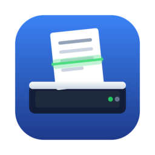
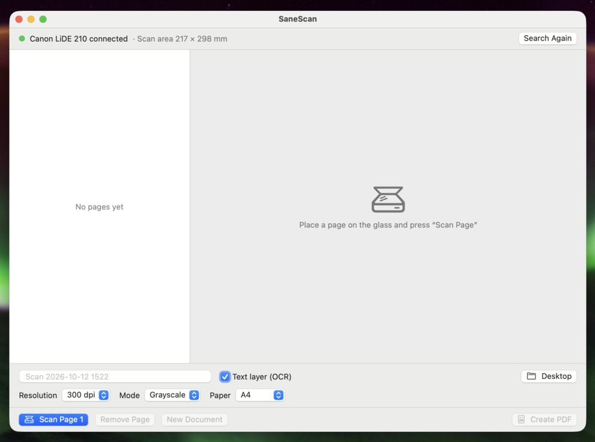

# SaneScan

A small, native macOS app that turns any scanner supported by
[SANE](http://www.sane-project.org/) into a multi-page PDF scanner with a
searchable text layer. Built for scanners whose manufacturers stopped shipping
macOS drivers, such as the Canon CanoScan LiDE series.

Put a page on the glass, press ⌘R, repeat, press ⌘S. Out comes one PDF with
all pages, OCR'd in German and English.



## What it does

- Lists every scanner SANE can see and lets you pick one if there are several.
- Reads the chosen scanner's capabilities (`scanimage -A`) and offers exactly
  the colour modes and resolutions the device supports.
- Scans page by page from a flatbed, or a whole stack at once from an
  automatic document feeder (ADF) when the scanner has one.
- Scan area presets (A4, A5, Letter, Legal, full bed), clamped to what the
  device can actually scan.
- Full-bed preview with four draggable corners to select a custom rectangular
  scan area. Corners also support arrow keys and VoiceOver actions.
- Pages can be reordered by dragging and removed with ⌫ before the PDF is
  written.
- Produces a JPEG-compressed PDF with CoreGraphics and adds an invisible,
  searchable text layer using Apple's on-device Vision framework. German and
  English recognition work without additional tools or language downloads.
  If recognition fails, the images are still saved and the status reports it.
- Choose PDF, PNG, JPEG or TIFF before pressing **Create**. PDF and lossless
  TIFF collect all pages in one file; PNG and JPEG export one image per page
  with numbered names for multi-page scans. OCR is available for PDF only.
- Remembers scanner, resolution, mode, paper size, export format, OCR setting and output
  folder between launches.
- Fully keyboard operable, labelled for VoiceOver.
- UI in English and German, following the system language.
- Integrated updates from GitHub Releases, with automatic checks and signed
  installation through Sparkle.

## Tested with

| Component | Version |
|---|---|
| Scanner | Canon CanoScan LiDE 210 (USB, SANE `genesys` backend) |
| macOS | 27.0.1 on Apple Silicon |
| sane-backends | 1.4.0 |

Scanner support depends on the bundled SANE backends. The
[SANE supported devices list](http://www.sane-project.org/sane-supported-devices.html)
tells you whether yours does. Reports of other models, working or not, are
welcome as issues.

## Download

Every tagged version has a disk image under
[Releases](https://github.com/iLord-DEV/sanescan/releases). Open it and drag
SaneScan into Applications.

The app is only ad-hoc signed, not notarized with Apple. On first launch macOS
will refuse to open a downloaded copy. Either right-click the app, choose
"Open" and confirm, or remove the quarantine flag once:

```sh
xattr -d com.apple.quarantine /Applications/SaneScan.app
```

Starting with v1.3.1, the app includes the scanner runtime. Users do not need
Homebrew, ImageMagick, ocrmypdf or Tesseract. Releases through v1.2 still require
those external tools.

Once a version with the integrated updater is installed, use **SaneScan → Check
for Updates…** ("Nach Updates suchen …") to download and install newer releases
inside the app. Automatic checks can be changed in the same menu. Installation
waits for active scans and unsaved pages. Older versions require one manual
upgrade to the first version with Sparkle.

## Requirements

- macOS 14 or newer.
- A scanner supported by the bundled SANE backends. Some models require
  separately obtained firmware; see [scanner runtime details](docs/scanner-runtime.md).
- Downloaded release builds target Apple Silicon. Source builds use the host
  architecture, including Intel.

## Build and run

There is no Xcode project. The Makefile wraps `swift build`, assembles the
`.app` bundle from `Info.plist` and a generated icon, builds and embeds a private
SANE runtime, and ad-hoc signs it. Developers need Xcode or the Swift toolchain
(Swift 5.10 or newer), Python 3, CMake and pkg-config. For example, install the
last two build tools with `brew install cmake pkgconf`. Homebrew is only a
convenience for the build machine. The first build downloads checksum-pinned
sources and takes several minutes; subsequent builds reuse the native build cache.

```sh
make run        # build release, assemble build/SaneScan.app, launch it
make install    # copy the bundle to /Applications
make dmg        # build/SaneScan.dmg with the app and an Applications link
make clean
swift test      # app tests, including native PDF export and Vision OCR
make verify-runtime # relocated virtual scan, with Homebrew paths denied
```

Pushing a tag like `v1.1` runs the release workflow, which builds the disk
image on a GitHub macOS runner with that version number and publishes a signed
update feed alongside it. The workflow requires the `SPARKLE_PRIVATE_KEY`
repository secret; see [update setup and release instructions](docs/updates.md).

The app is not sandboxed because its private scanner process needs direct USB
access through libusb. See [runtime build, licenses and verification](docs/scanner-runtime.md).

## Usage

1. Start the app. The status bar shows the detected scanner and its maximum
   scan area. With several scanners connected a popup lets you choose.
2. Put a page on the glass and press ⌘R ("Seite scannen"). With an ADF
   selected as source, ⌘R scans every page in the feeder.
   To scan a specific area on a flatbed, first click "Select Area…"
   ("Bereich wählen …"). The app scans a low-resolution preview of the whole
   glass. Drag its four corner handles, then click "Use Scan Area". The next
   scans use that position and size at the selected resolution. The preview
   itself is never added to the PDF. Choose a paper preset to reset the area.
   Custom areas require reported bed dimensions and last until a different
   paper preset, scanner or source is selected, or scanners are searched again.
3. Repeat for every page. Drag pages to reorder, ⌫ removes the selected one.
4. Pick the file name, **File format** ("Dateiformat"), resolution, mode, paper
   size and output folder in the settings bar. PDF also offers a text layer (OCR).
5. Click **Create** ("Erstellen") or press ⌘S. PDF and TIFF save one file;
   multi-page PNG/JPEG exports use `<name>-001.png` / `<name>-001.jpg`, etc.
   Single-page image exports use the name without a number. Existing files
   require confirmation before replacement. ⌘N starts a new document and
   discards the scanned pages.

Scanned pages remain in a temporary folder for further exports until a new
document is started or the app exits.

## How it works

Scanning uses the private `ScannerRuntime/bin/scanimage` executable, launched
off the main thread with bundled backends, libraries and default configuration:

1. `scanimage -L` to list devices, `scanimage -d <device> -A` to read the
   device's option list. The modes, resolutions and `-x`/`-y` limits are
   parsed from that output (`Sources/SaneScan/ScannerDevice.swift`).
2. `scanimage -d <device> --resolution N --mode M --source S -x W -y H --format=png`
   for each page, or the same with `--batch=` for a feeder. One PNG per page.
   Custom areas additionally pass `-l X -t Y` for the top-left position.
PDF export uses CoreGraphics, CoreText and ImageIO; optional text recognition
uses Vision. PNG, JPEG and TIFF exports also use ImageIO. All export work runs
off the main thread. Output files are prepared in a temporary directory
inside the output folder before installation. Replacement failures restore
the original files; scanned source images are kept for retrying.

### A note on device names

Some backends (the `genesys` backend on macOS among them) re-enumerate the USB
device every time it is opened, so the address in `genesys:libusb:002:001`
flips to `002:002` and back. Passing that full string to `scanimage -d` then
fails with "Invalid argument". SaneScan therefore addresses a scanner by its
bare backend name (`-d genesys`) whenever only one device of that backend is
connected, and only falls back to the full device string when it has to tell
two scanners of the same backend apart.

### Localization

English strings in the sources are the keys; `Resources/de.lproj/Localizable.strings`
holds the German translation and the Makefile copies the `.lproj` folders into
the bundle. A unit test fails when a string used in the sources has no German
entry. To add a language, add `Resources/<lang>.lproj/Localizable.strings` and
list the language in `Info.plist` under `CFBundleLocalizations`.

To try the other language without changing the system setting:

```sh
open build/SaneScan.app --args -AppleLanguages "(de)"
```

### Icon

`Assets/AppIcon.svg` is the source, `Assets/AppIcon.png` its rendered 1024 px
version. `make icon-png` re-renders the PNG with QuickLook after editing the
SVG; the normal build only scales the PNG with `sips` and packs it with
`iconutil`, so it needs nothing beyond macOS.

## Limitations

- One scanner is used at a time; there is no duplex handling beyond what the
  backend's source option offers.
- Custom scan areas are rectangular; perspective correction is not supported.
- OCR languages are fixed to German and English.
- Only tested with the hardware listed above.
- The standalone runtime has been checked with a virtual scanner while
  Homebrew and build directories were inaccessible. Testing on a fresh macOS 14
  installation and with physical scanners using this runtime is still pending.

## License

The app source is [MIT](LICENSE). Bundled scanner components have their own
licenses, including the GPL for SANE's command line frontend and libtiff's,
libpng's, libusb's and libjpeg-turbo's licenses. License notices and complete
matching source archives with rebuild instructions are included inside the
app at `Contents/Resources/ScannerRuntime/share/`.
